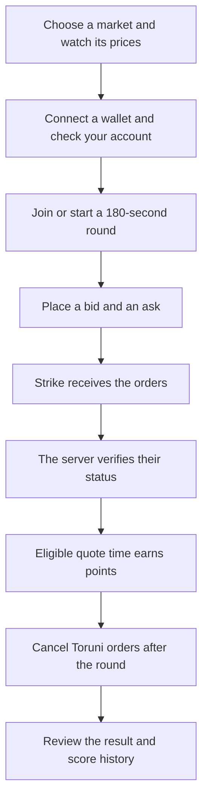
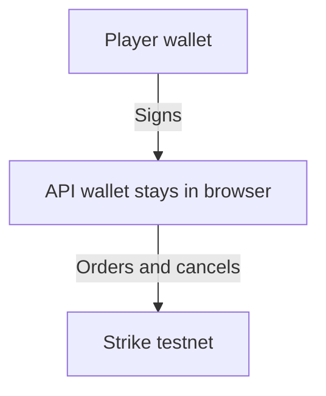
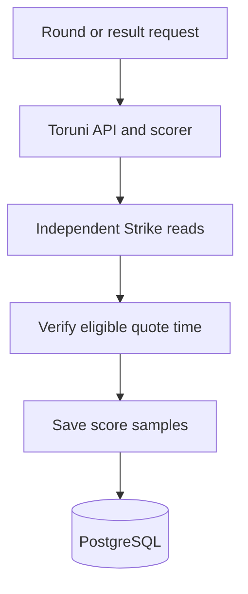

# Toruni

Toruni is a 180-second market-making challenge. Players practice providing liquidity by placing a bid and an ask, then earn points while their quotes stay open and competitive.

Choose BTC-USD, ETH-USD or SOL-USD before starting a challenge. Each round uses one market, with its own order sizes, price increments and minimum order value. Market availability follows Strike V2 testnet; markets with inconsistent trading limits stay unavailable. We plan to add more markets as Strike makes them available.

The arena includes a price trend drawn from Strike’s candle history and recent verified offers from all makers. The activity feed keeps up to 40 offers, with four visible at a time.

[Open the arena](https://toruni.vercel.app/) · [How a round works](#a-round) · [Run locally](#run-locally)


*The lobby shows market data, the round state, and current standings.*

## A round



A quote earns points only after the server confirms that the exact order is open and competitive. Requests that Strike accepts are not enough by themselves. Missing or stale market, account, or order evidence earns zero for that sample.

## How scoring works

Each eligible side receives a quality from `0` to `1`. Quality is highest at the market mark and falls linearly to zero 50 basis points away. If `B` is bid quality and `A` is ask quality, the scoring rate is:

```text
points per minute = 25 × B + 25 × A + 50 × min(B, A)
```

A competitive quote can earn its side points. Keeping both the bid and ask competitive also earns a two-sided bonus based on the weaker quote. A quote must remain eligible through a five-second observed dwell period. Missed seconds are not backfilled. The results show saved order states and the score history.

## Orders and account requirements

Toruni sends post-only limit orders to Strike Finance V2 testnet. To enter a round, connect an Ethereum-compatible wallet and use a Strike V2 testnet account with trading collateral already credited. Faucet tokens in a wallet are not the same as collateral credited to a Strike account.

Offers stay open until you cancel them, including after a round ends. You can cancel Toruni offers from the app without affecting other account orders. If an offer fills, canceling it does not close the resulting position.

## How orders and scores are handled

### Order authorization



### Independent scoring



The wallet signs Builder Connect to register an Ed25519 API wallet. The browser keeps its private key in tab memory and sends user-approved orders and exact Toruni-order cancellations to Strike. The server never receives the key or submits, cancels, or closes exchange orders.

The verifier reads market, account-risk, and order state independently from Strike. Authenticated exchange requests are pinned to `https://api-v2-testnet.strikefinance.org`. Mainnet is not a configurable target.

The market is fixed when a round is created. Admission, risk checks, quote intents and scoring use that saved market. The public activity feed returns the latest independent observation for each offer, without wallet addresses or account identifiers.

## Run locally

Use Node.js 22.18 or newer and npm.

```sh
npm install
cp .env.example .env.local
```

Set these values in `.env.local`:

- `VITE_BUILDER_CODE`: public builder code registered for Strike V2 testnet.
- `VITE_BUILDER_FEE_BPS`: builder fee share. The example sets this to `0`; Strike trading fees may still apply.
- `VITE_WALLETCONNECT_PROJECT_ID`: optional public WalletConnect Cloud project ID. Installed browser wallets work without it; WalletConnect QR and mobile wallet pairing require it.
- `DATABASE_URL`: server-only PostgreSQL connection for application queries. A pooler URL is supported.
- `DATABASE_URL_UNPOOLED`: server-only direct PostgreSQL connection for the scorer’s leader lock.
- `APP_ORIGIN`: exact browser origin, normally `http://localhost:5173`.
- `TORUNI_MAX_QUOTE_NOTIONAL`: maximum value for one resting quote, in USD.
- `TORUNI_MAX_ACCOUNT_EXPOSURE`: maximum gross exposure for positions and Toruni quotes, in USD. It must cover two maximum quotes.

Keep database URLs server-only. Do not prefix them with `VITE_`, which would expose them to the browser. Risk limits must be configured before a round accepts participants.
For WalletConnect, register `toruni.vercel.app` and your local development origin in the WalletConnect project’s allowed origins, then set its project ID before building.

```sh
npm run migrate
npm run dev
```

Vite serves the interface and API together. Refreshing or closing the tab loses the in-memory API wallet.

To build and run the standalone Node service:

```sh
npm run build
npm run start:server
```

It serves `dist/` and the API on port 4174 by default. Set `APP_ORIGIN` to the browser URL and run migrations before starting a new schema version.

## Deployment

The public app is [toruni.vercel.app](https://toruni.vercel.app/). Vercel builds with `npm run build`, serves `dist/`, and routes requests through the handlers in `api/`. A separate deployment needs its own server-only database connections for persisted rounds and scoring. The direct connection keeps the PostgreSQL leader lock on one session. Session cookies trust Vercel’s deployment URL unless `APP_ORIGIN` is set for a custom domain. See [`vercel.json`](vercel.json) for build settings, function limits, and client-side routes.

On Vercel, a successful round join starts a bounded scorer job. A request can restart it if the saved heartbeat is stale. PostgreSQL elects one scoring leader, and the scorer samples through the round and settlement window. The worker runs during a round, not between rounds. The standalone Node service can keep a worker running continuously and supports a persistent event stream.

## Project map

- `src/`: interface, wallet connection, Builder Connect, and browser-side Strike order requests.
- `server/`: sessions, HTTP API, independent Strike reads, round lifecycle, verification, and scoring.
- `shared/`: typed contracts, exact decimal checks, scoring policy, and deterministic ledger replay.
- `sql/`: ordered PostgreSQL migrations, including the supported-market constraint.
- `api/`: Vercel HTTP entry points.
- `tests/`: scoring, validation, lifecycle, API, and worker checks.

## Checks

```sh
npm run typecheck
npm test
npm run build
```

Automated tests use isolated test data and do not submit trades. Passing tests or a local build does not replace a genuine Strike testnet round.

## Attribution and license

Strike request and signing behavior follows the [Strike Builder Reference](https://github.com/strike-finance/strike-builder-reference) and [official Strike API documentation](https://docs.strikefinance.org/api). Toruni does not copy Strike application code, icons, or branding assets. The project is MIT licensed.

The interface uses bundled Plus Jakarta Sans from Fontsource 5.3.0 under the SIL Open Font License. See [`src/assets/plus-jakarta-sans-LICENSE.txt`](src/assets/plus-jakarta-sans-LICENSE.txt).
