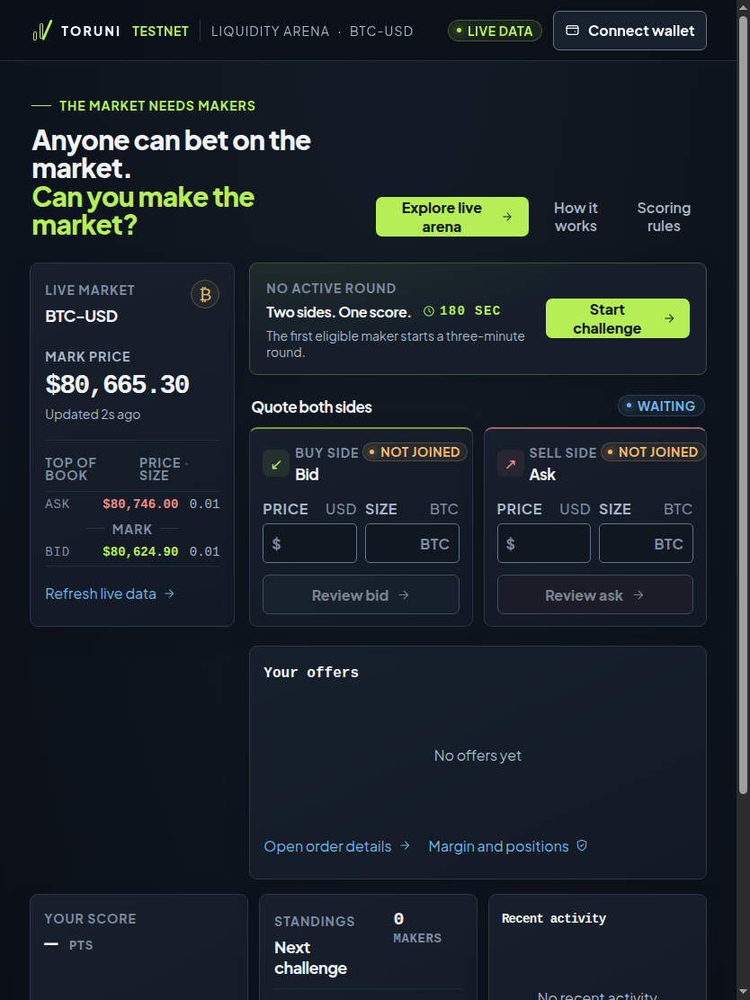
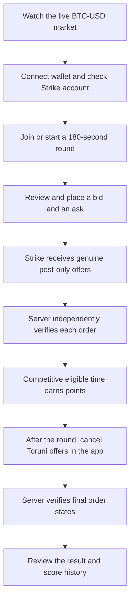
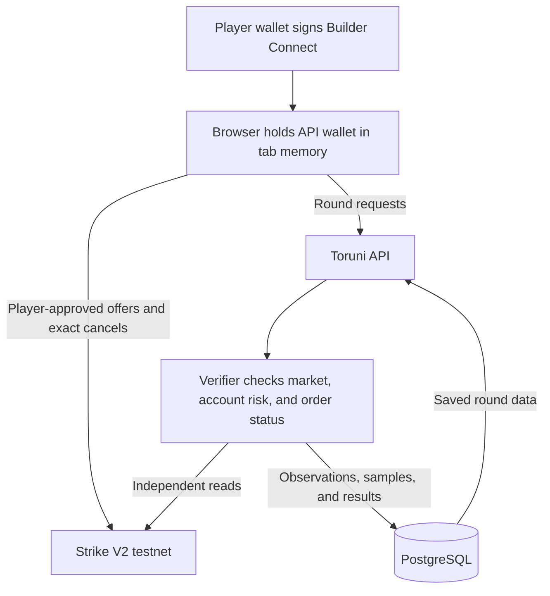

# Toruni

**Keep both sides quoted. Compete on consistency.**

Toruni helps traders practice providing two-sided liquidity in BTC-USD on Strike Finance V2 testnet. In each 180-second round, players place real post-only bid and ask orders. Toruni’s server checks that the orders remain open and competitive, then scores eligible quote time. The market data and orders come from Strike testnet, not simulated trades.

[Open the live arena](https://toruni.vercel.app/) · [Judge walkthrough](#for-judges) · [Developer setup](#for-developers)



*The lobby shows live market data and a waiting-round state. Prices and round status change with Strike testnet activity.*

## For judges

### What to look for

Open the [live arena](https://toruni.vercel.app/) to watch the BTC-USD mark, order book, and round state. You can explore the market without connecting a wallet.

To take part, you need an Ethereum-compatible browser wallet and a Strike V2 testnet account with trading collateral already credited. A wallet’s faucet balance is not the same as collateral credited to a Strike account. Toruni checks the account and risk limits before allowing a round entry.

### One round, from quote to result



The score comes from quotes that Strike reports as open and the server continues to verify. An accepted order request alone is not enough. After 180 seconds, offers remain open until the player cancels them. A filled offer can leave a position behind; canceling an offer does not close that position.

### How the score works

Each eligible side receives a quality from `0` to `1`. Quality is highest at the market mark and falls linearly to zero 50 basis points away. If `B` is bid quality and `A` is ask quality, the scoring rate is:

```text
points per minute = 25 × B + 25 × A + 50 × min(B, A)
```

The two-sided bonus uses the weaker quote, so competitive bids and asks both matter. A single eligible side can earn its side points, but not the two-sided bonus.

A quote earns points only while all of these conditions hold:

- Strike independently reports the exact Toruni order as open for the player’s account, market, and side.
- The order is a post-only limit offer and remains open until canceled.
- The offer stays eligible through a five-second observed dwell period.
- Market, order, and account-risk evidence is fresh, and the remaining offer value meets Strike’s current market minimum.

Missing or stale evidence earns zero for that sample. Missed seconds are never backfilled. The results page shows the saved order states and per-second score history.

## For developers

### Trust and data flow



The browser keeps the Ed25519 API-wallet private key in tab memory. It sends user-approved offers and cancels for exact Toruni order IDs. The server never receives that key and never submits, cancels, or closes exchange orders. It reads Strike independently, verifies order state, and calculates the score.

Authenticated exchange requests are pinned to `https://api-v2-testnet.strikefinance.org`. Mainnet is not a configurable target.

### Scoring runtime

Vercel starts a bounded background scorer after a successful round join. A current-round request can restart it if its database heartbeat is stale. PostgreSQL elects one scoring leader, and the scorer samples through the round and its settlement window. The worker is continuous during a round, not between rounds. A persistent Node host can run the same worker continuously.

The Vercel functions are configured for up to 300 seconds, which covers the 180-second round and settlement window. On Vercel, the client reads persisted results through the HTTP API. The standalone Node service also supports a persistent event stream.

### Run locally

Use Node.js 22.18 or newer and npm.

```sh
npm install
cp .env.example .env.local
```

Set these values in `.env.local`:

- `VITE_BUILDER_CODE`: public builder code registered for Strike V2 testnet.
- `VITE_BUILDER_FEE_BPS`: builder fee share. The example sets this to `0`; Strike trading fees may still apply.
- `DATABASE_URL`: server-only PostgreSQL connection for application queries. A pooler URL is supported.
- `DATABASE_URL_UNPOOLED`: server-only direct PostgreSQL connection for the scorer’s leader lock.
- `APP_ORIGIN`: exact browser origin, normally `http://localhost:5173`.
- `TORUNI_MAX_QUOTE_NOTIONAL`: maximum value for one resting quote, in USD.
- `TORUNI_MAX_ACCOUNT_EXPOSURE`: maximum gross exposure for positions and Toruni quotes, in USD. It must cover two maximum quotes.

Keep database URLs server-only. Do not prefix them with `VITE_`, which would expose them to the browser. Risk limits must be explicitly configured before a round accepts participants.

```sh
npm run migrate
npm run dev
```

Vite serves the interface and API together. Refreshing or closing the tab loses its in-memory API wallet.

To build and run the standalone Node service:

```sh
npm run build
npm run start:server
```

It serves `dist/` and the API on port 4174 by default. Set `APP_ORIGIN` to the browser URL and run migrations before starting a new schema version.

### Deployment

The public app is [toruni.vercel.app](https://toruni.vercel.app/). Vercel builds with `npm run build`, serves `dist/`, and routes requests through the handlers in `api/`. A separate deployment needs its own server-only database connections for persisted rounds and scoring. The direct connection keeps the PostgreSQL leader lock on one session. Session cookies trust Vercel’s deployment URL unless `APP_ORIGIN` is set for a custom domain. See [`vercel.json`](vercel.json) for build settings, function limits, and client-side routes.

### Code map

- `src/`: interface, wallet connection, Builder Connect, and browser-side Strike order requests.
- `server/`: sessions, HTTP API, independent Strike reads, round lifecycle, verification, and scoring.
- `shared/`: typed contracts, exact decimal checks, scoring policy, and deterministic ledger replay.
- `sql/`: ordered PostgreSQL migrations.
- `api/`: Vercel HTTP entry points.
- `tests/`: scoring, validation, lifecycle, API, and worker checks.

### Checks

```sh
npm run typecheck
npm test
npm run build
```

The automated tests use isolated test data and do not submit trades. A passing test suite or local build does not replace a genuine Strike testnet round.

## Attribution and license

Strike request and signing behavior follows the [Strike Builder Reference](https://github.com/strike-finance/strike-builder-reference) and [official Strike API documentation](https://docs.strikefinance.org/api). Toruni does not copy Strike application code, icons, or branding assets. The project is MIT licensed.

The interface uses bundled Plus Jakarta Sans from Fontsource 5.3.0 under the SIL Open Font License. See [`src/assets/plus-jakarta-sans-LICENSE.txt`](src/assets/plus-jakarta-sans-LICENSE.txt).
