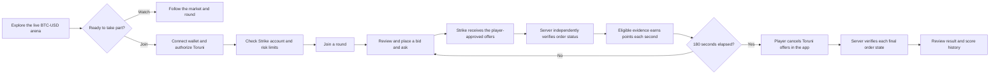
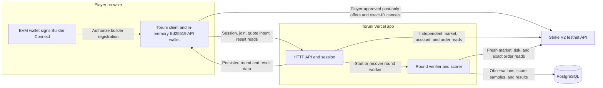

# Toruni

**Anyone can bet on the market. Can you make the market?**

Toruni turns liquidity making into a three-minute challenge on Strike Finance V2 testnet. Quote a BTC-USD bid and ask, keep them competitive, and earn points only when the server can verify the exchange evidence behind them.

[Open the live arena](https://toruni.vercel.app/) · [See how scoring works](#scoring) · [Run Toruni locally](#run-locally)


*The lobby shows live market data and a waiting-round state. Prices and round status change with Strike testnet activity.*

| Challenge | 180 seconds |
| --- | --- |
| Market | BTC-USD |
| Exchange | Strike Finance V2 testnet |
| Result | Server-verified score with a per-second audit trail |
| Trading authority | The player’s browser, after wallet authorization |

## The challenge

The first eligible maker starts a round. Players join, review their risk limits, then submit a bid and an ask as separate post-only limit offers. Offers stay open until canceled, including after the round ends. A fill can create a position, so canceling an offer does not close that position.

### Player journey



### What a judge can try

1. Open the [live arena](https://toruni.vercel.app/) and inspect the current BTC-USD mark, order book, and round state. The lobby can be explored without a wallet.
2. To participate, connect an Ethereum-compatible browser wallet and approve the Builder Connect message. Toruni creates an Ed25519 API wallet in the browser; the private key stays in tab memory.
3. Use a Strike V2 testnet account with trading collateral already credited. Testnet faucet tokens held in a wallet are not the same as collateral credited to a Strike account.
4. Check the account and displayed risk limits, join the round, then review each bid or ask before placing it.
5. Follow order verification and scoring in the arena. When the round ends, cancel Toruni offers individually and inspect their verified final states and the score history.

If an offer fills, the resulting position remains the player’s responsibility. Toruni shows position risk and never closes positions automatically.

## Scoring

Each eligible bid and ask receives a quality value from `0` to `1`. Quality is `1` at the market mark and decreases linearly to `0` at 50 basis points away. Let `B` be bid quality and `A` be ask quality:

```text
points per minute = 25 × B + 25 × A + 50 × min(B, A)
```

The two-sided bonus uses the weaker side, so keeping both offers competitive matters. A single side can earn its side points, but cannot earn the two-sided bonus.

| Evidence Toruni checks | Scoring effect |
| --- | --- |
| Strike independently reports the exact offer as open for the bound account, market, and side | Unverified or terminal offers earn no credit |
| Offer is a post-only limit order that stays open until canceled | Other order types are not eligible |
| Current market and order observations are fresh, and the offer stays eligible for a five-second dwell | Stale evidence, missing samples, or interrupted dwell earn zero for that sample |
| Remaining offer value meets the current Strike minimum notional and the account remains within its risk limits | Undersized or unsafe offers earn no credit |

Toruni reads market constraints from Strike’s market API. It does not trust the browser’s reported order status, price, or score. The server samples once per second, uses exact decimal arithmetic, stores the observations and score samples in PostgreSQL, and never backfills missed intervals. The results page exposes the saved order states and score history for review.

## How the system works



The exchange write path stays in the player’s browser. Toruni’s server never receives the API-wallet private key and never submits, cancels, or closes exchange orders. It independently reads Strike to verify order state and calculate the score.

Both client and server pin exchange traffic to `https://api-v2-testnet.strikefinance.org`. Mainnet is not a configurable target.

On Vercel, a bounded background worker starts after a successful round join and can be restarted when the round’s scoring heartbeat goes stale. It samples throughout the round and settlement window, with PostgreSQL electing one scoring leader. It is continuous during a round, not an always-running process between rounds. A persistent Node host can run the same scorer continuously.

## Run locally

Use Node.js 22.18 or newer and npm.

```sh
npm install
cp .env.example .env.local
```

Set the required values in `.env.local`:

| Variable | Purpose |
| --- | --- |
| `VITE_BUILDER_CODE` | Public builder code registered for Strike V2 testnet |
| `VITE_BUILDER_FEE_BPS` | Builder fee setting; `.env.example` uses `0` |
| `DATABASE_URL` | Server-only PostgreSQL connection for app queries; a pooler URL is supported |
| `DATABASE_URL_UNPOOLED` | Server-only direct connection used for the scoring leader lock |
| `APP_ORIGIN` | Exact browser origin, normally `http://localhost:5173` |
| `TORUNI_MAX_QUOTE_NOTIONAL` | Maximum value allowed for one resting quote, in USD |
| `TORUNI_MAX_ACCOUNT_EXPOSURE` | Maximum gross exposure for positions and Toruni quotes, in USD; must cover two maximum quotes |

Keep both database URLs server-only. Do not prefix them with `VITE_`, which would expose them to the browser. Risk limits must be explicitly configured before a round accepts participants.

```sh
npm run migrate
npm run dev
```

Vite serves the interface and API together. The API-wallet private key is held in tab memory and is lost when that tab is refreshed or closed.

To build and run the standalone Node service:

```sh
npm run build
npm run start:server
```

The service serves `dist/` and the API on port 4174 by default. Configure `APP_ORIGIN` for the browser URL and run migrations before starting a new schema version.

## Deployment

The public app is [toruni.vercel.app](https://toruni.vercel.app/). Vercel builds with `npm run build`, serves `dist/`, and routes API requests through the handlers in `api/`. The Vercel function limit is 300 seconds, which accommodates a round and its settlement window.

For a separate Vercel project, configure the variables listed above in the appropriate environments. The two database URLs are required for persisted rounds and scoring; the direct URL keeps the database leader lock on one PostgreSQL session. Session cookies trust Vercel’s deployment URL unless `APP_ORIGIN` is set for a custom domain. See [`vercel.json`](vercel.json) for the build, API limits, and client-side routes.

## Code map

| Path | Responsibility |
| --- | --- |
| `src/` | Interface, wallet connection, Builder Connect, and browser-side Strike order requests |
| `server/` | Sessions, API, independent Strike reads, round lifecycle, verifier, and scorer |
| `shared/` | Typed contracts, exact decimal checks, scoring policy, and deterministic ledger replay |
| `sql/` | Ordered PostgreSQL migrations |
| `api/` | Vercel HTTP entry points |
| `tests/` | Scoring, validation, lifecycle, API, and worker regression tests |

## Checks

```sh
npm run typecheck
npm test
npm run build
```

The automated tests use isolated test data and do not submit trades. A passing test suite or local build does not replace a genuine Strike testnet round.

## Attribution and license

Strike request and signing behavior follows the [Strike Builder Reference](https://github.com/strike-finance/strike-builder-reference) and [official Strike API documentation](https://docs.strikefinance.org/api). Toruni does not copy Strike application code, icons, or branding assets. The project is MIT licensed.

The interface uses bundled Plus Jakarta Sans from Fontsource 5.3.0 under the SIL Open Font License. See [`src/assets/plus-jakarta-sans-LICENSE.txt`](src/assets/plus-jakarta-sans-LICENSE.txt).
